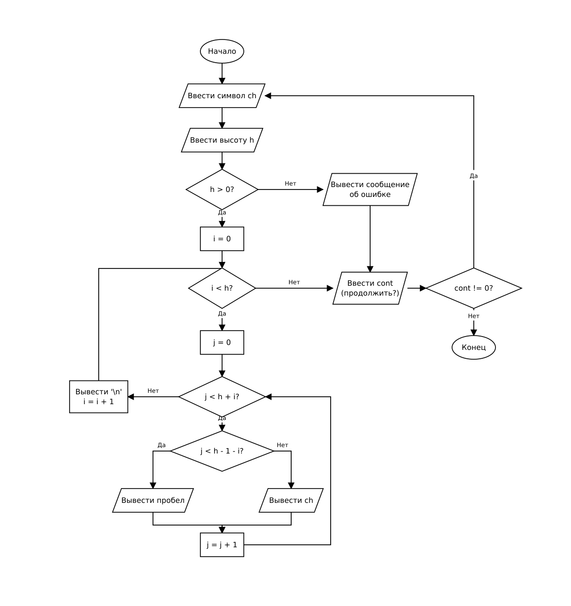

# Домашнее задание к работе 9

## Условие задачи (Вариант 2)

Написать программу, выводящую на экран заданную в **ДЗ к лабораторной работе № 6** геометрическую фигуру «Равнобедренный треугольник» (ограниченную прямыми $y_1 = x + 4$, $y_2 = -x + 4$ и осью $Ox$), нарисованную с помощью заданного с клавиатуры символа.

Предусмотреть возможность изменения размеров фигуры путем задания пользователем ее высоты $h$ (в количестве строк/символов).

Обеспечить повторение выполнения программы в цикле с постусловием `do-while` до тех пор, пока пользователь не захочет ее завершить.

---

## 1. Алгоритм и блок-схема

### Алгоритм

1. Настроить русскую локализацию для корректного вывода сообщений.
2. Организовать цикл с постусловием `do-while` для возможности многократного выполнения программы.
3. Запросить у пользователя и считать символ `ch`, из которого будет строиться фигура.
4. Запросить и считать высоту треугольника `h` (количество строк).
5. Проверить корректность введенного размера: высота должна быть строго больше нуля (`h > 0`).
6. Если высота некорректна, вывести сообщение об ошибке и перейти к запросу продолжения работы.
7. Если высота корректна:
   - инициализировать счётчик строк `i = 0`;
   - запустить внешний цикл по строкам (`i < h`):
     - инициализировать счётчик столбцов `j = 0`;
     - запустить вложенный цикл по столбцам (`j < h + i`):
       - проверить условие отступа: если `j < h - 1 - i`, вывести пробел `' '`;
       - иначе вывести заданный символ фигуры `ch`;
       - увеличить `j = j + 1` и повторить шаг для следующего символа;
     - после завершения строки вывести перевод строки `\n`, увеличить `i = i + 1` и перейти к следующей строке.
8. Запросить у пользователя ввод признака продолжения работы (`cont`: любое число — продолжить, 0 — завершить).
9. При вводе ненулевого значения повторить шаги с пункта 3, при вводе нуля завершить выполнение программы.

### Блок-схема



*Исходник схемы для draw.io: [Lab9_AlgSchema.drawio](Lab9_AlgSchema.drawio)*

---

## 2. Реализация программы

Исходный код программы: [Source.c](Source.c)

---

## 3. Результаты работы программы

Пример 1 — равнобедренный треугольник высотой 4 (как в ДЗ 6), символ `*`:

```
Введите символ из которого будет строиться фигура:
*
Введите высоту треугольника h:
4
Равнобедренный треугольник (фигура из ДЗ 6):
   *
  ***
 *****
*******
Продолжить ? (Да - введите любое число, Нет - введите 0)
1
```

Пример 2 — изменение размера фигуры (высота 6, символ `#`):

```
Введите символ из которого будет строиться фигура:
#
Введите высоту треугольника h:
6
Равнобедренный треугольник (фигура из ДЗ 6):
     #
    ###
   #####
  #######
 #########
###########
Продолжить ? (Да - введите любое число, Нет - введите 0)
1
```

Пример 3 — ввод некорректного размера и завершение работы:

```
Введите символ из которого будет строиться фигура:
@
Введите высоту треугольника h:
0
Ошибка: некорректный размер фигуры (высота должна быть больше нуля).
Продолжить ? (Да - введите любое число, Нет - введите 0)
0
```

---

## 4. Информация о разработчике

- **ФИО:** Аносов Сергей Юрьевич
- **Группа:** бОТИ-261
