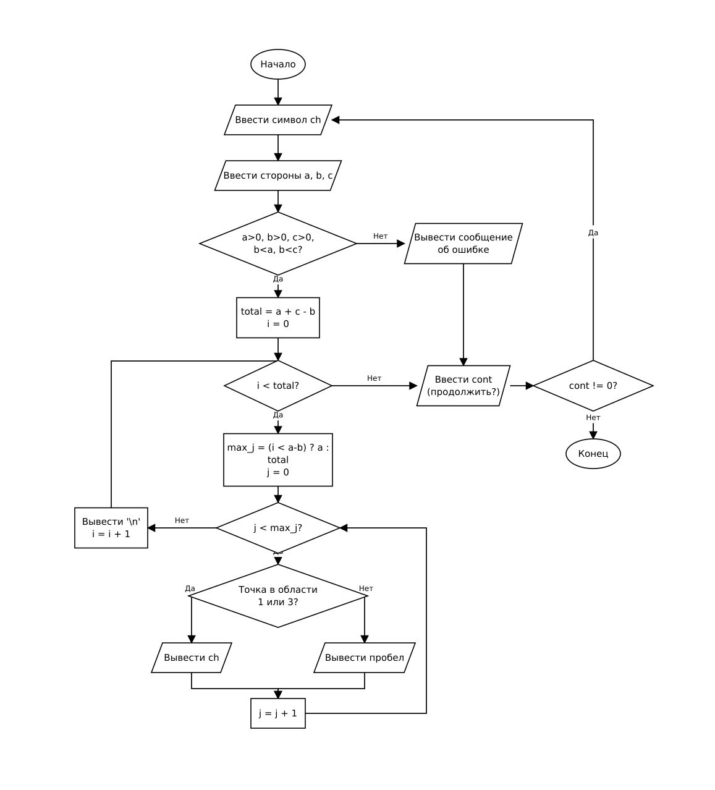

# Домашнее задание к работе 9

## Условие задачи (Вариант 2)

Написать программу, выводящую на экран заданную геометрическую фигуру «Два квадрата», нарисованную с помощью заданного с клавиатуры символа.

Предусмотреть возможность изменения размеров фигуры путем задания ее размеров пользователем (сторона 1, сторона 2 и сторона 3). Область пересечения квадратов должна оставаться пустой.

Обеспечить повторение выполнения программы в цикле `do-while` до тех пор, пока пользователь не захочет ее завершить.

---

## 1. Алгоритм и блок-схема

### Алгоритм

1. Настроить русскую локализацию для корректного вывода сообщений.
2. Организовать цикл с постусловием `do-while` для возможности многократного выполнения программы.
3. Запросить у пользователя и считать символ `ch`, из которого будет строиться фигура.
4. Запросить и считать размеры фигуры: `a` (сторона первого квадрата), `b` (сторона области пересечения), `c` (сторона второго квадрата).
5. Проверить корректность введенных размеров: стороны должны быть больше нуля, а сторона пересечения `b` должна быть строго меньше сторон обоих квадратов (`b < a` и `b < c`).
6. Если размеры некорректны, вывести сообщение об ошибке и перейти к запросу продолжения работы.
7. Если размеры корректны:
   - рассчитать общие размеры области вывода: `total = a + c - b`;
   - инициализировать счётчик строк `i = 0`;
   - запустить внешний цикл по строкам (`i < total`):
     - определить максимальный индекс столбца текущей строки `max_j = (i < a - b) ? a : total` и инициализировать счётчик столбцов `j = 0`;
     - запустить вложенный цикл по столбцам (`j < max_j`):
       - определить попадание в закрашенную область фигуры: если точка принадлежит первому либо второму квадрату, но не их пересечению (`in_sq1 ^ in_sq2`), вывести символ `ch`;
       - иначе вывести пробел;
       - увеличить `j = j + 1` и повторить шаг для следующего символа строки;
     - после завершения строки вывести перевод строки `\n`, увеличить `i = i + 1` и перейти к следующей строке.
8. Запросить у пользователя ввод признака продолжения работы (любое число — продолжить, 0 — завершить).
9. При вводе ненулевого значения повторить шаги с пункта 3, при вводе нуля завершить выполнение программы.

### Блок-схема



---

## 2. Реализация программы

Исходный код программы: [Source.c](Source.c)

---

## 3. Результаты работы программы

Пример 1 — квадраты со сторонами 4 и 4, перекрытие 2, символ `*`:

```
Введите символ из которого будет строиться фигура:
*
Введите сторону 1:
4
Введите сторону 2:
2
Введите сторону 3:
4
Два квадрата:
****
****
**  **
**  **
  ****
  ****
Продолжить ? (Да - введите любое число, Нет - введите 0)
1
```

Пример 2 — квадраты разных размеров (сторона 1 = 5, сторона 2 = 2, сторона 3 = 4, символ `#`):

```
Введите символ из которого будет строиться фигура:
#
Введите сторону 1:
5
Введите сторону 2:
2
Введите сторону 3:
4
Два квадрата:
#####
#####
#####
###  ##
###  ##
   ####
   ####
Продолжить ? (Да - введите любое число, Нет - введите 0)
1
```

Пример 3 — ввод некорректных размеров и завершение работы:

```
Введите символ из которого будет строиться фигура:
*
Введите сторону 1:
3
Введите сторону 2:
3
Введите сторону 3:
4
Ошибка: некорректные размеры фигуры.
Продолжить ? (Да - введите любое число, Нет - введите 0)
0
```

---

## 4. Информация о разработчике

- **ФИО:** Аносов Сергей Юрьевич
- **Группа:** бОТИ-261
